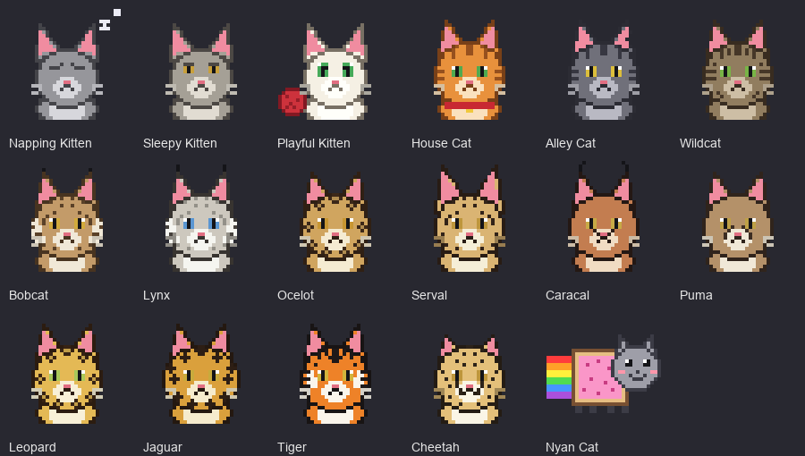

# CatXP =^.^=

A tiny, cat-themed XP per hour tracker for **World of Warcraft: Forever**. One small window
with a cat portrait, five rate windows and five buttons, a tooltip with the numbers, a
right-click menu, a details panel, a graphs window with five tabs, and a leaderboard with live
standings, all-time records and races against your friends. No libraries. Eight Lua files,
seventeen cats and more than 2,200 cat facts, a different one on every announcement. If you ask
it to, it also tracks your raw gold per hour.

Your XP/hour rate is ranked as a cat. Faster cat, rarer colour. Each cat has its own portrait,
shown in the window, the tooltip, the details panel, the chat lines and the Cats tab. The ladder
runs from 10k to 35k, where levelling rates usually sit: one cat covers everything below 10k,
fifteen cats fill the band (2k steps up to 20k, then 1.5k steps up to 35k), and one cat covers
everything above 35k.



| XP / hour | Cat | | XP / hour | Cat |
|---|---|---|---|---|
| under 10k | Napping Kitten | | 24.5k | Serval |
| 10k | Sleepy Kitten | | 26k | Caracal |
| 12k | Playful Kitten | | 27.5k | Puma |
| 14k | House Cat | | 29k | Leopard |
| 16k | Alley Cat | | 30.5k | Jaguar |
| 18k | Wildcat | | 32k | Tiger |
| 20k | Bobcat | | 33.5k | Cheetah |
| 21.5k | Lynx | | 35k and up | Nyan Cat |
| 23k | Ocelot | | | |

Each number is the bottom of that cat's band. The window border and the tier name take the
tier's colour and follow your rate every second. Chat hears from CatXP far less often. When your
session has moved to a different cat, CatXP says so in one line: a promotion with the cat's
proud line, or a demotion with its sadder one. Four rules keep that from turning into noise.

- **One line per pace.** CatXP says at most one automatic line every five minutes, whether it is
  about a new cat or a new leader on the leaderboard. `/catxp pace 10`, or `Chat pace` in the
  menu, changes the five to anything from 1 to 60 minutes. News that comes too soon is not
  queued. When the pace allows a line again, CatXP tells whatever is true by then, so a rate
  that climbed two cats and came back down is never mentioned at all.
- **Said once.** In a party, raid or instance group the line goes to that group's chat as plain
  text ("reached", "is back to" or "slipped to"), where you read it yourself. It is printed in
  your own chat, with the portrait, only when no group heard it: playing alone, or with party
  announcements off.
- **Only while you play.** A rate that slides while you travel, trade or stand at a vendor says
  nothing. The whole slide is told in one line when XP comes in again.
- **Not in the first five minutes.** A young session's rate jumps with every kill, so it is not
  announced until it has settled. A slip also only counts once the rate is a few hundred xp/h
  under the old cat's floor, so a rate hovering on a boundary stays quiet.

Race starts and results always go at once, because you asked for the race. `/catxp party` or
the menu turns the group messages off; `/catxp announce` controls the ones in your own chat.

Every announcement ends with a real cat fact, and you never hear the same one twice in a hurry.
Each of the seventeen cats has its own facts about that species (the cheetah's three-second
sprint to 100 km/h, the jaguar's skull-piercing bite, Nyan Cat's charity-stream origin, 273 in
all), said on its promotions and demotions until every one of them has been heard once. After
that, and for the level-cleared, lead-change and race lines, a bank of 2,275 facts takes over:
the body and the senses, behaviour, kittens and care, breeds, coats and records, history, famous
cats, the wild cousins, and cats in language, stories and folklore. The bank is dealt like a
shuffled deck, each fact once, with your place in the deck saved account-wide, so a new session,
a `/reload` or another character carries on where you left off instead of starting the same
facts over. Only when the whole deck has been heard is it shuffled again. `/catxp fact` (or the
menu) tells you one on demand and shows how far through the deck you are.

## Install

1. Copy the `CatXP` folder (the one containing `CatXP.toc`) to
   `C:\Program Files (x86)\World of Warcraft\_forever_\Interface\AddOns\CatXP`.
   The `Media` folder with the cat pictures has to come along.
2. **Restart the game completely.** Forever does not pick up a newly added addon on `/reload`.
3. Make sure CatXP is ticked in the AddOns list on the character screen.

Upgrading from 1.x, 2.x or 3.0: copy over the old folder and restart the game completely (3.1
adds a file, which `/reload` will not pick up). From 3.1 to a later release, 3.2 included,
copying the folder and a `/reload` is enough. Sessions, per-level history and settings carry
over. After the upgrade to 3.2 the chat pace is five minutes and gold tracking is off until you
turn it on.

The TOC also lists the Classic Era interface number, so the same folder loads on Classic Era.

## The window

```
+------+  CatXP =^.^=                              tracking
| cat  |  Alley Cat  17.2k xp/h
| pic  |  1h 23m  |  25,120 xp  |  2h 05m to lvl
+------+  Lv 34  42.3%  |  85 kills to lvl
  -------------------------------------------------------
  15 min   15m 00s   4.9k xp   19.6k/h   [=] Wildcat
  Hour     1h 00m   17.4k xp   17.4k/h   [=] Alley Cat
  Session  1h 23m   25.1k xp   17.2k/h   [=] Alley Cat
  Level    2h 40m   41.0k xp   15.4k/h   [=] House Cat
  Today    3h 52m   60.2k xp   15.6k/h   [=] House Cat
  Gold     1h 23m   14g 20s    10g 26s/h
     Pause    Reset    Details   Graphs    Board
```

- **Portrait**: the cat for your current session rate.
- **Line 1**: status. `tracking`, `paused` or `idle`.
- **Line 2**: your cat and the session XP/hour. Reads `Warming up... 42s` for the first minute.
- **Line 3**: active session time, XP gained this session, time to level at the session rate.
- **Line 4**: level, percent into the level, kills to level (average XP of your last 10 kills).
- **Rate windows**: the same XP/hour over five spans, each with its time, XP, rate and the cat
  that rate earns (small portrait and name): the last 15 active minutes, the last active hour,
  the session, the current level (since you reached it) and today (everything tracked since
  local midnight, across resets and sessions). A row reads `warming` until it has a minute of
  data. `/catxp windows`, or the menu, hides the rows and shrinks the window back to the four
  lines.
- **Gold row**: only with gold tracking on (see Gold per hour below): the time gold has been
  counted, the coin earned this session and the coin per hour.
- **Buttons**: `Start` / `Pause`, `Reset`, `Details`, `Graphs`, `Board`.

## Where the controls are

Every control is reachable more than one way. Pick whichever you like.

| Action | Window button | Right-click menu | Details panel | Slash command |
|---|---|---|---|---|
| Start tracking | `Start` | Start tracking | `Start` | `/catxp start` |
| Pause | `Pause` (same button) | Pause tracking | `Pause` | `/catxp stop` |
| Reset the session | `Reset` | Reset session | `Reset` | `/catxp reset` |
| Details panel | `Details` or left-click | Show details | close button | `/catxp details` |
| Graphs window | `Graphs` or shift-left-click | Show graphs | `Graphs` | `/catxp graphs` |
| Leaderboard | `Board` or ctrl-left-click | Show leaderboard | | `/catxp board` |
| Start a race | Race tab of the leaderboard | | | `/catxp race 30` |
| Rate windows on or off | | Show rate windows | | `/catxp windows` |
| How often chat hears from CatXP | | Chat pace | | `/catxp pace 5` |
| Gold per hour on or off | | Track gold per hour | | `/catxp gold` |
| A cat fact, right now | | A cat fact, please | | `/catxp fact` |
| Lock the window | | Lock window | `Lock` | `/catxp lock` |
| Clear history | | Clear history... | `Clear` | `/catxp clearhistory` |

You rarely need Start: with auto-start on (the default) the clock starts on the first XP you
gain. Pause is the only pause: it stays paused until you press Start again, even if XP comes
in, and nothing pauses the clock on its own. Going AFK, standing around or sitting in a queue
all count as session time. The clock simply does not run while you are logged out and picks up
again when you log back in.
The addon compartment button next to the minimap opens the details with a left-click and the
graphs with a right-click. Escape closes the details, the graphs and the leaderboard.

Mouse on the window:

- **Hover** for the full breakdown: last-15-minute and last-hour rates, kills and average kill
  XP, quest/other XP, rested XP, zone, this level's time and rate, today's time, XP and rate,
  the average of finished levels, and the next cat. With gold tracking on: coin per hour, coin
  earned, and how much of it was looted coin, quest coin and item value.
- **Left-click** opens the details panel. **Shift-left-click** opens the graphs.
  **Ctrl-left-click** opens the leaderboard.
- **Right-click** opens the menu: start/pause, reset, details, graphs, leaderboard, a cat fact,
  auto-start, chat and party announcements, chat pace, rate windows, gold tracking, lock, clear
  history, hide.
- **Drag** to move (when unlocked). The graphs and leaderboard windows drag too.

## How tracking works

- **Session** = XP gained and active (unpaused) seconds since the last reset. It survives
  `/reload` and logging out; the clock only runs while you are logged in and tracking.
- **Reset** starts a fresh session. A session of at least a minute is saved to the session
  history first (the last 40 are kept), so the Sessions tab can compare them.
- **Per level**: every level you track gets its own time, XP, kills and XP/hour. When you level,
  the rest of the old bar is credited to the old level and the new bar to the new level, and a
  chat line sums up the level you just finished. The details panel lists the last ten levels and
  the average time and rate across finished levels.
- **Per zone**: within a session, time, XP and kills are also booked to the zone you are in,
  so the Zones tab can show where the XP comes from.
- **Today**: XP, active time and kills since local midnight, kept per character and untouched by
  Reset, so the Today window keeps counting across sessions.
- **Quest turn-ins count.** XP is read from the XP bar, so quests, discovery, kills and anything
  else all land in the session. Only kills are counted separately, from the combat chat line.
- Everything is stored per character (`CatXPCharDB`). Window positions, scale and options are
  account-wide (`CatXPDB`).

## Gold per hour

Off until you turn it on with `/catxp gold` or `Track gold per hour` in the menu. It measures
what your play earns, in three parts:

- **Looted coin**: the coin you pick up from corpses and chests, your share in a group included.
- **Quest coin**: the coin a quest pays when you hand it in.
- **Items**: what a vendor would pay for every item that lands in your bags, whether looted,
  gathered or given as a quest reward, counted the moment you pick it up.

With it on, the main window gets a `Gold` row under the rate windows, the tooltip and the
details panel show the split between the three parts and the rate over the last 15 minutes, the
last hour, this level and today, and `/catxp status` adds a gold line. Coin also starts the
session clock when auto-start is on, so it works at level 60, where no XP is left to start it.

What it leaves out, on purpose:

- Money you spend. This is income, not the change in your purse, so a repair bill or a flight
  does not lower it.
- Anything at a vendor, the mailbox, the auction house, a guild bank or in a trade. Selling your
  loot is not counted, because those items were already counted at vendor price when you picked
  them up, and auction sales, mail and gifts are not what the play earned.
- Things you craft or conjure, and other players' loot.
- Anything while the session is paused or gold tracking is off. Gold has its own clock, so
  turning it on halfway through a session gives a rate for the time it was on.

Gold stays on your screen. It is not on the leaderboard, not in the messages CatXP sends to other
copies, and no gold line is ever posted to chat.

## Details panel

- Session block: start time, active time, XP, XP/hour (with the cat), last 15 minutes,
  time to level, kills (with average and kills-to-level), quest/other XP.
- Chart: XP per 5 minutes over the last active hour, each bar coloured by the cat tier that
  rate would earn. Peak value shown top right.
- Per-level table: level, time, XP, XP/hour (tier coloured), kills. Current level in green.
- Gold block, with gold tracking on: coin per hour with the total and the counted time, the
  split between coin, quests and items, and the rate over the last 15 minutes, the last hour,
  this level and today. The panel grows to make room.
- Buttons: Start/Pause, Reset, Graphs, Lock/Unlock, Clear (asks first; clears levels and
  sessions).

## Graphs window

`/catxp graphs`, the `Graphs` button, shift-left-click on the window, or the menu. It redraws
every five seconds while open and remembers the last tab.

- **Session**: rolling 5-minute XP/hour over the session as a line, your session average as a
  reference line, green ticks where you levelled. Below: totals, your best five minutes, kills
  and quest XP, level-ups.
- **Levels**: one bar per tracked level, coloured by cat, the current level brighter, the
  average of finished levels as a line. Hover a bar for the numbers. Below: fastest and slowest
  level, tracked time, and an estimate of the time to level 60 at your average rate.
- **Zones**: one bar per zone of this session with at least two minutes in it, up to ten.
  Below: the top five zones with time, XP, rate and kills.
- **Sessions**: one bar per saved session, oldest to newest, plus the current one marked `now`.
  Below: totals across sessions, the best one, the last three.
- **Cats**: the whole ladder with every portrait and threshold, your current cat lit up. Hover a
  cat for its words of wisdom. Below: your rate, the next cat and how much more it takes.

## Leaderboard

`/catxp board`, the `Board` button, ctrl-left-click on the window, or the menu. Three tabs,
redrawn every two seconds while open. Escape closes it.

Copies of CatXP talk to each other over the game's addon channel, which never shows up in chat.
While you track, your numbers go to your party, raid or instance group and to your guild every
20 seconds (every 10 during a race), and theirs come back. Only people who run CatXP see any of
it, and the `Party` and `Guild` buttons on the Live tab (or `/catxp shareparty` and
`/catxp shareguild`) switch each channel off.

```
+-----------------------------------------------------------+
|  CatXP leaderboard  =^..^=                              x  |
|  [ Live ]  [ Records ]  [ Race ]                           |
|                        (crown)                             |
|          2 Jesse        1 Carmine        3 Mo              |
|          24.1k xp/h     27.3k xp/h       19.8k xp/h        |
|  #  Cat        Lvl  Tier       XP / h  Session  5 min      |
|  1  Carmine     34  Caracal     27.3k    41.2k   +1.2k     |
|  2  Jesse       31  Serval      24.1k    36.0k       =     |
|  3  Mo          35  Wildcat     19.8k    12.4k   -2.0k     |
|  2 other cats online.  Sharing: party on, guild on.        |
|  [Party: on]     [Guild: on]     [Lead msgs: on]           |
+-----------------------------------------------------------+
```

- **Live**: everyone running CatXP in your group or guild, ranked by session XP/hour. The top
  three stand on a podium with their cat portraits and a crown on the leader. The table lists
  rank, cat portrait and name (class coloured), level, tier, XP/hour, session XP and the change
  against five minutes ago. Your row is gold, and a cat that has been quiet for 90 seconds drops
  off. Hover a row for the full numbers, the zone and where the cat was seen (party, guild or
  both). A cat still warming up shows as such instead of a rate. Only real players are listed:
  nobody who is not running CatXP, and no made-up rows.
- **Records**: all-time bests for every cat this account has met, you and your alts included,
  ranked by best XP/hour: best XP/hour with its cat, biggest session, fastest level and the
  number of sessions. A session rate needs 30 minutes to count and a level counts only if it was
  tracked from its first XP, so a lucky ten minutes does not top the board. Friends' bests arrive
  with their updates and stay after they log off. `Clear records` asks first.
- **Race**: pick 10, 30 or 60 minutes, or `/catxp race 45` for any length up to four hours.
  Everyone in the group with CatXP joins the moment you start, the start is announced in group
  chat, and the tab counts down over a live bar chart of XP gained since the start, class
  coloured, your bar brighter. When time is up, the starter posts the results to group chat
  ("CatXP Race over! 1. Jesse 8.2k xp  2. Carmine 7.9k xp") and the tab keeps them until the
  next race. The starter can call a race off with `Stop race` or `/catxp race stop`.
- **Lead changes**: when you overtake the leader of the live board and hold it, your copy says
  so in group chat ("CatXP: Jesse takes the lead from Carmine at 27.3k xp/h"), or in your own
  chat when no group would hear it. It takes the same turn as the tier lines, so there is at
  most one automatic line per chat pace, and a lead that flips straight back is never
  announced. Losing the lead to someone in your group says nothing more, since their copy has
  just told the group. Losing it to a guildmate outside your group gets you a line of your own.
  Two other cats trading places is not announced. `Lead msgs` or `/catxp leadmsgs` turns all of
  it off.

## Slash commands

`/catxp` or `/cxp`

| Command | Effect |
|---|---|
| `start`, `stop`, `toggle`, `reset` | Control the session clock |
| `details` | Open or close the details panel |
| `graphs` | Open or close the graphs window |
| `board`, `lb` | Open or close the leaderboard |
| `race <minutes>`, `race stop` | Start a race for your group, or call yours off |
| `show`, `hide`, `lock`, `unlock` | Window |
| `scale <0.5-2.5>`, `alpha <0.1-1>` | Window size and opacity |
| `autostart`, `announce`, `party` | Toggle the options |
| `windows` | Show or hide the five rate windows on the main window |
| `pace <1-60>` | Minutes between automatic chat lines (5 by default); without a number, shows it |
| `gold`, `gold on`, `gold off` | Gold per hour tracking on or off |
| `fact` | A cat fact right now, and how far through the deck you are |
| `shareparty`, `shareguild`, `leadmsgs` | Toggle the leaderboard options |
| `tiers` | Print the cat ladder |
| `status` | One-line summary in chat |
| `resetlevels` | Clear the per-level history |
| `resetsessions` | Clear the session history |
| `clearhistory` | Clear both |
| `clearrecords` | Clear the leaderboard records |

## The cats

The portraits are 64x64 pixel-art TGA files in `Media/`, one per tier, drawn by
`tools/make_cats.py` (one folder up). To change a cat, edit its colours or features in that
script and re-run it, or drop in your own 64x64 32-bit uncompressed TGA with the same name.
WoW does not load PNG.

To change the tiers themselves, open `Core.lua` and edit the `CatXP.TIERS` table near the top.
Each row has the minimum XP/hour, the name, a hex colour, the portrait path, a fallback icon,
a quip for the way up and a sadder one for the way down. Keep the rows sorted by `min`. Nothing
else needs to change.

The cat facts live in `FactBank.lua`: one list per cat name, then the bank in ten subject blocks.
That file is generated by `tools/build_facts.py` from the plain-text files in `tools/facts/`
(one fact per line; `tiers.txt` holds the per-cat lists under `[Cat Name]` headers), which
checks every line and drops duplicates. Add facts there and run the script, or edit
`FactBank.lua` directly if you never plan to run it again. Either way: plain ASCII, under 140
characters, a capital first letter, a full stop at the end and never the `|` character, which
WoW reads as a text code. The tests check every line. `Facts.lua` holds the dealing: the deck
is a shuffle rebuilt from a saved seed, so your place in it survives a reload, and a version
that changes the number of facts starts a fresh pass.

## Known limits

- Kills are counted from the "X dies, you gain N experience." chat line. In zones where the
  client restricts chat text to addons (some dungeons and raids under the Midnight-era rules),
  kills may not be counted there. XP itself is always tracked from the XP bar.
- Gaining two levels from a single XP award credits the middle level's bar to the new level.
- XP gained while manually paused, or while the addon is disabled, is not counted anywhere.
- The level 60 estimate uses the 2004 XP table for levels you have not reached yet. If Forever's
  table differs, the estimate is off by that much.
- Zones are booked by the zone name the client reports, so subzones of one zone are merged and
  instances show under their own name.
- English chat strings are used as a fallback if the client's own format string is unavailable.
- `Today` is your computer's calendar day: the addon reads the local date, so a session that runs
  past midnight is split between the two days.
- A new version with a different number of cat facts starts a fresh pass through the deck, so a
  few facts you have already heard can come round again.
- Gold: items are valued at vendor price, not at what the auction house would pay, and an item
  no vendor buys counts as nothing. An item is counted when you pick it up, whatever you do with
  it afterwards. One the client has not loaded yet is valued as soon as it has, or dropped after
  30 seconds.
- Gold: coin that arrives within two seconds of a quest turn-in is filed under quests, so coin
  looted in that same moment lands there too. The total is right either way.
- Gold: in zones where the client hides chat text from addons, picked-up items may not be seen
  there. Coin is read from your purse and is always counted.
- A group member on CatXP 3.1 or older still posts its own lines at the old one-a-minute pace.
- The leaderboard knows only players who run CatXP 3.0 or newer with sharing on, in your group
  or guild. Every number comes from that player's own addon, so it is as honest as their clock.
- Forever shows characters with a longer name in chat than the one the game hands the addon
  ("Meow Thecat" against "Meow"). CatXP tags every message it sends with a random token so it
  recognises its own echo on the group channel regardless of the name, and your own row takes
  the longer name as soon as that first echo arrives. Copies older than 3.0.3 listed you twice;
  3.0.3 removes the stray entry on login.

## Development

The logic can be exercised without the game. `tools/` (one folder up from this addon) holds a
small mock of the WoW API and five scenario files: `test_catxp.lua` (version 1 behaviour, 109
checks), `test_catxp_v2.lua` (zones, history, graphs, buttons, 76 checks), `test_catxp_v3.lua`
(the leaderboard: addon messages, live rows, records, races, the window, the cat facts and the
own-echo token, 79 checks), `test_catxp_v31.lua` (the fact bank and its deck, the rate windows
and the last-resort gap on group chat, 47 checks) and `test_catxp_v32.lua` (the chat pace,
lines said once and only while you play, lead changes, and gold tracking with its sources,
exclusions, clock and display, 96 checks). `tools/build_facts.py` rebuilds `FactBank.lua` and
needs nothing beyond Python.
They need Python with the `lupa` package, which bundles Lua 5.1, the dialect WoW uses. Drawing
the cats needs Pillow.

```
pip install lupa pillow
python ../tools/run_tests.py .
python ../tools/make_cats.py . ../cats_preview.png
```
